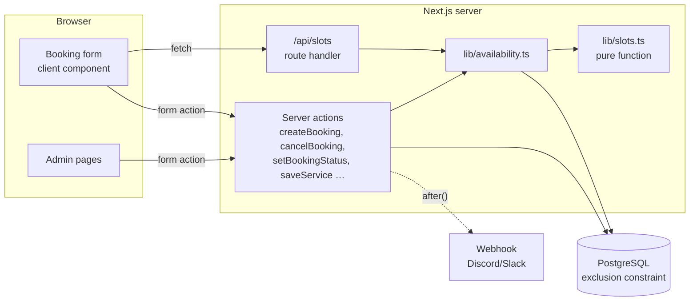

# QueueEase — Online booking for small shops


A full-stack appointment booking system for barbershops, salons, clinics and other single-chair businesses.
Customers pick a service and a free time slot and get a booking code; the owner manages the day's queue,
services and opening hours from an admin dashboard.

**Stack:** Next.js 16 (App Router, Server Actions) · TypeScript · PostgreSQL · Drizzle ORM · Tailwind CSS 4 ·
Zod · Vitest · Playwright · Docker · GitHub Actions

## Features

**Customers**

- Browse services with duration and price, see weekly opening hours
- 4-step booking: service → day (closed days disabled) → available time → contact details
- Booking confirmation page with a 6-character code (no ambiguous characters such as `0/O`, `1/I`)
- Look up a booking by code + phone; cancel online up to 2 hours before (verified with the last 4 digits of the phone)

**Shop owner (`/admin`)**

- Daily schedule with one-click status changes: completed / no-show / cancelled (with undo)
- Stats: today's bookings, next 7 days, this month's revenue, no-show rate
- Manage services (price edits never rewrite past bookings — name and price are snapshotted)
- Weekly opening hours and one-off closures (public holidays)
- Optional webhook notification (Discord/Slack) on every new or cancelled booking

## Engineering highlights

### 1. Double booking is impossible — enforced by the database

Checking "is this slot free?" in application code and then inserting has a race condition: two customers
can pass the check at the same moment. QueueEase adds a PostgreSQL **exclusion constraint**:

```sql
ALTER TABLE bookings ADD CONSTRAINT bookings_no_overlap
  EXCLUDE USING gist (tstzrange(starts_at, ends_at, '[)') WITH &&)
  WHERE (status <> 'cancelled');
```

Any two active bookings with overlapping time ranges are rejected atomically (error `23P01`), which the
server action turns into a friendly "someone just booked this slot" message. An integration test fires
10 concurrent inserts for the same slot and asserts that exactly one succeeds
([`src/db/no-double-booking.test.ts`](src/db/no-double-booking.test.ts)). The half-open range `[)` means
10:00–10:30 and 10:30–11:00 do not conflict.

### 2. Slot generation is a pure, tested function

[`src/lib/slots.ts`](src/lib/slots.ts) takes opening hours, existing bookings, service duration, the
current time and a minimum lead time, and returns available start times. No database or framework code
inside, so it is covered by fast unit tests (closing-time fit, overlaps, lead time, DST in other timezones).

### 3. Timezones done properly

All timestamps are stored as `timestamptz` (UTC). Business hours like "10:00–20:00" are interpreted in the
shop's IANA timezone (`SHOP_TIMEZONE`, default `Asia/Bangkok`) using only `Intl` — so the app behaves the
same whether the server runs in UTC (Vercel, Docker) or locally.

### 4. Never trust the client

- Every server action re-validates input with Zod and recomputes slot availability before inserting.
- Admin server actions call `requireAdmin()` themselves — server actions are public HTTP endpoints, so
  hiding a button is not authorization.
- Sessions are signed JWTs (HS256, `jose`) in `httpOnly`, `SameSite=Lax` cookies; passwords hashed with bcrypt.
- Login is throttled (5 failures / 15 min per email) and runs bcrypt even for unknown emails so response
  time doesn't reveal which accounts exist.
- Abuse limit: max 3 upcoming bookings per phone number.

## Architecture



Notifications run with Next.js `after()`, so a slow webhook never delays the customer's response.

## Getting started

### Option A — Docker (everything)

```bash
docker compose up --build
# → http://localhost:3000   admin: admin@example.com / admin1234
```

### Option B — local Node.js + Docker database

Requires Node.js 20.9+.

```bash
cp .env.example .env            # then set AUTH_SECRET
docker compose up -d db         # or use any PostgreSQL 14+
npm install
npm run db:migrate
npm run db:seed                 # admin account + demo services/hours
npm run dev                     # → http://localhost:3000
```

## Scripts

| Script                                  | What it does                                        |
| --------------------------------------- | --------------------------------------------------- |
| `npm run dev` / `build` / `start`       | Next.js dev server / production build / serve build |
| `npm run db:generate`                   | Generate a SQL migration after editing `schema.ts`  |
| `npm run db:migrate` / `db:seed`        | Apply migrations / insert admin + demo data         |
| `npm test`                              | Unit tests (+ DB integration test if configured)    |
| `npm run test:e2e`                      | Playwright end-to-end tests (desktop + mobile)      |
| `npm run lint` / `typecheck` / `format` | ESLint / `tsc --noEmit` / Prettier                  |

**Integration test:** set `TEST_DATABASE_URL` to a separate, migrated database — the test deletes all
bookings in it. **E2E tests** need a migrated + seeded database and a production build (`npm run build`).

## Project structure

```
src/
  app/                 Routes (App Router)
    book/              Booking flow (server page + client form)
    booking/[code]/    Booking detail + cancel
    admin/             Login + dashboard, services, hours (protected route group)
    api/slots/         Available slots JSON endpoint
  actions/             Server actions (booking, admin, auth)
  db/                  Drizzle schema, connection, DB integration test
  lib/                 Pure logic (slots, time, format) + server helpers (availability, auth, session)
  components/          UI primitives
drizzle/               SQL migrations (incl. custom exclusion-constraint migration)
e2e/                   Playwright tests
scripts/               migrate + seed
```

## Deploying

Works on any Node host. A typical free setup: **Vercel** for the app + **Neon** or **Supabase** for
PostgreSQL. Set `DATABASE_URL`, `AUTH_SECRET` and optionally `SHOP_NAME` / `NOTIFY_WEBHOOK_URL`, then run
`npm run db:migrate && npm run db:seed` once against the production database. The `btree_gist` extension
is available on both Neon and Supabase.

## Possible next steps

- Multiple staff members / chairs (add `staff_id` to the exclusion constraint)
- SMS or LINE Messaging API reminders the day before
- Customer accounts with booking history
- Online deposit payment (Omise / Stripe test mode)
